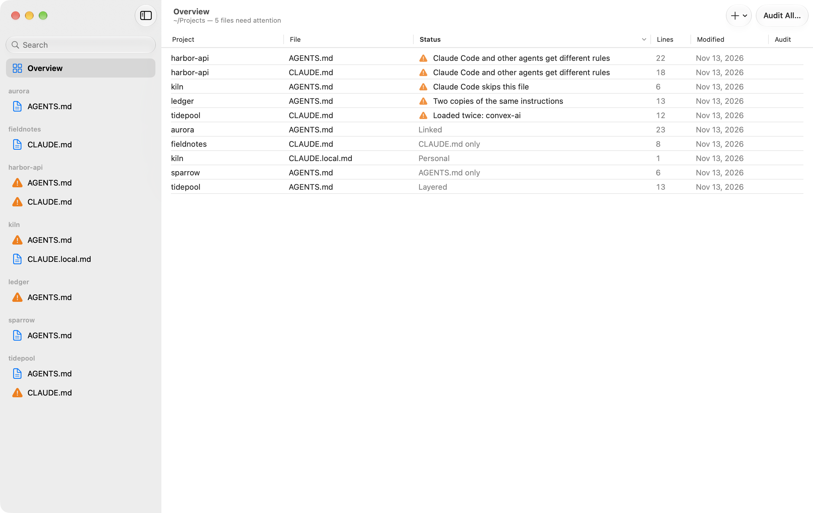
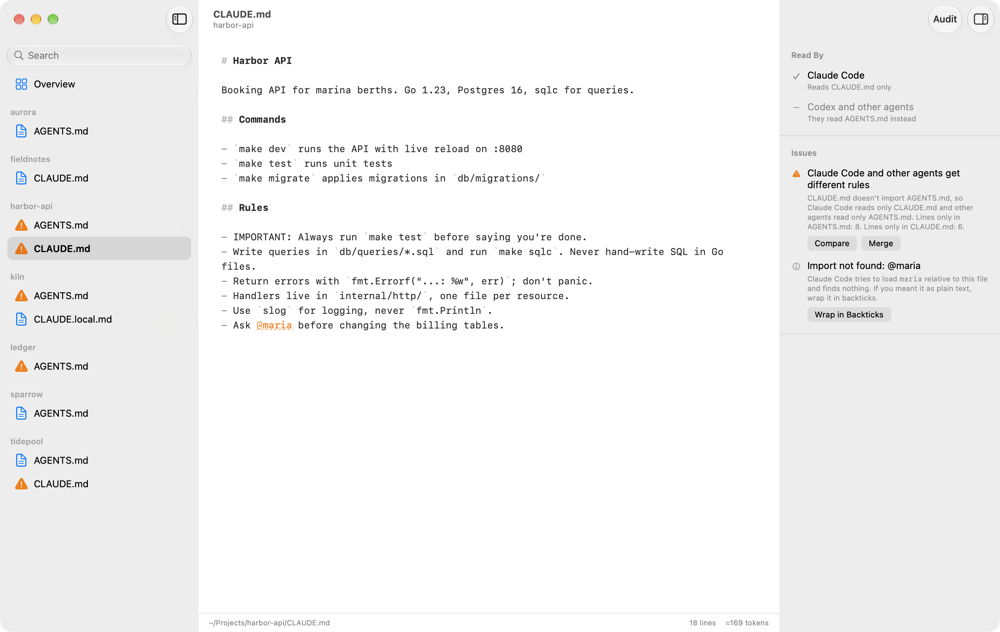
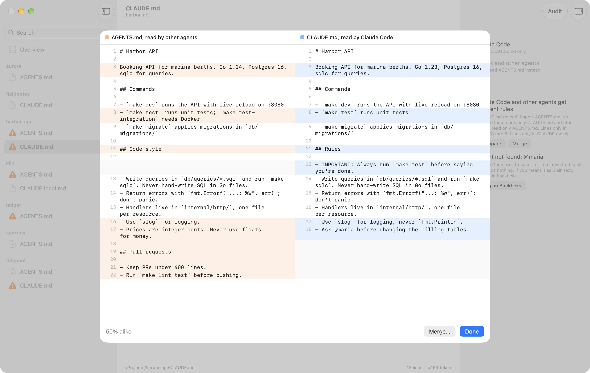
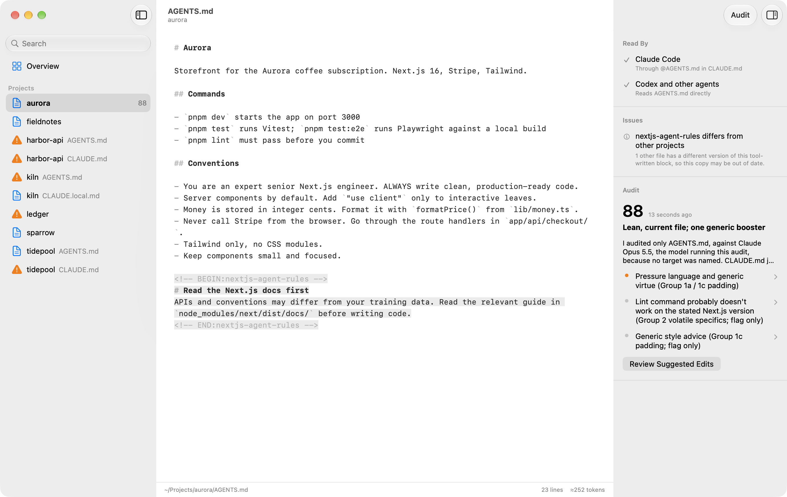

# Rulebook

**[Download for macOS](https://github.com/disinfeqt/rulebook/releases/latest/download/Rulebook.zip)** · [rulebook.duxi.ao](https://rulebook.duxi.ao)

A native macOS app for the agent instruction files across your projects. Point it at the folder that holds your projects and it finds every `CLAUDE.md`, `AGENTS.md` and `CLAUDE.local.md`, works out how they relate, and lets you edit, compare, merge and audit them in one place.



The interface comes in English and Simplified Chinese (简体中文). It follows the system language, or the one you pick in Settings, and audits are written in the same language.

## What it understands

| Status | Meaning |
|---|---|
| Linked | `CLAUDE.md` is only `@AGENTS.md`, or a symlink to it. Shown as one file. |
| Layered | `CLAUDE.md` imports `AGENTS.md` and adds Claude-only rules. |
| Duplicated | Two identical copies. Shown as one file; saving writes both. |
| Diverged | Separate files with different content: Claude Code reads only `CLAUDE.md`, other agents only `AGENTS.md`. |
| Skipped by Claude Code | `AGENTS.md` hidden by a `CLAUDE.local.md` or a parent `CLAUDE.md`. |

It also flags broken `@imports`, stray `@mentions` that Claude Code would try to import, tool-written blocks (such as `convex-ai` or `nextjs-agent-rules`) that are loaded twice or differ between projects, files over 200 lines, and titles left over from copied files. Most issues come with a one-click fix.



## Compare and merge

When `CLAUDE.md` and `AGENTS.md` have drifted apart, Compare shows them side by side. Merge asks your agent to combine them into one `AGENTS.md` and a `CLAUDE.md` that imports it plus any Claude-only rules. You review the result before anything is saved.



## Audits

Audit (⇧⌘A) checks a file against its project: instructions written for older models, references to files and commands that don't exist, and rules that contradict each other. You get a score, findings that jump to the text they're about, and suggested edits as a diff. Audit All (⌥⇧⌘A) works through every file that is new or has changed, and "Audit files again when they change" in Settings keeps results current.



Audits and merges run through an agent CLI you already have, with its existing login:

| Agent | How it audits | How it's kept read-only |
|---|---|---|
| Claude Code 2.1.283+ | its own `/doctor prompt-audit` | `--restricted --strict-mcp-config`, only Read, Glob and Grep |
| Codex | the prompt in `AgentService.auditPrompt` | `--sandbox read-only --ignore-user-config` |

Rulebook uses the first one it finds. Settings lets you pick the agent, a model (the CLI's default otherwise) and the command's path. Runs count toward that login's usage. A typical audit takes about a minute.

## Keys

⌘O open folder · ⌘S save · ⌥⌘S save all · ⌥⌘↓ / ⌥⌘↑ next / previous file · ⇧⌥⌘↓ next file that needs attention · ⌥⌘D compare · ⇧⌘M merge · ⌘R rescan · ⌥⌘I inspector

## Install

Download [Rulebook.zip](https://github.com/disinfeqt/rulebook/releases/latest/download/Rulebook.zip), open it, and drag Rulebook to your Applications folder. It needs macOS 14 or later.

Releases are signed and notarized by Apple, and run on Apple silicon and Intel Macs.

## Build

Open `Rulebook.xcodeproj` in Xcode 26 or later and run. The app runs on macOS 14 or later.

From the command line:

```sh
xcodebuild -project Rulebook.xcodeproj -scheme Rulebook -configuration Release -derivedDataPath build build
open build/Build/Products/Release/Rulebook.app
```

## Development

The app's own binary, `Rulebook.app/Contents/MacOS/Rulebook`, takes a few arguments:

- `Rulebook --dump <folder>` prints the analysis without opening a window.
- `Rulebook --root <folder> --audit <file>` runs one audit headless and stores the result where the app reads it. Add `--agent claude|codex` or `--model <name>` to choose.
- `--root <folder>`, `--no-global` and `--store <folder>` point the app at another folder and audit store without changing your settings.

`./scripts/release.sh` builds the app for both Mac architectures, signs it with a Developer ID, has Apple notarize it, and publishes it as a GitHub release. The website in `docs/` is deployed from this repository, and its download button always points at the latest release.

Two scripts regenerate checked-in files:

- `swift scripts/make-icon.swift` redraws the icon. It rewrites the layered `Resources/AppIcon.icon` (open it in Icon Composer to preview) and the logo files in `docs/logo`.
- `./scripts/screenshots.sh` rebuilds the screenshots above from the made-up projects in `scripts/make-demo.sh`. Add `--audit` to run a real audit for `audit.png`.

### Translations

Every string is written in English in the source, and the English text is its key. `Resources/zh-Hans.lproj/Localizable.strings` holds the Chinese. After changing any text, run `./scripts/check-strings.py`: it lists keys that are missing, unused, or whose format arguments don't match. To add a language, copy that file to a new `Resources/<code>.lproj` and translate it. Xcode picks the folder up on the next build.

## License

[MIT](LICENSE)
