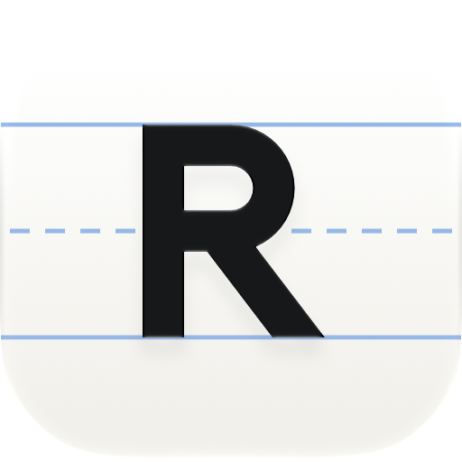
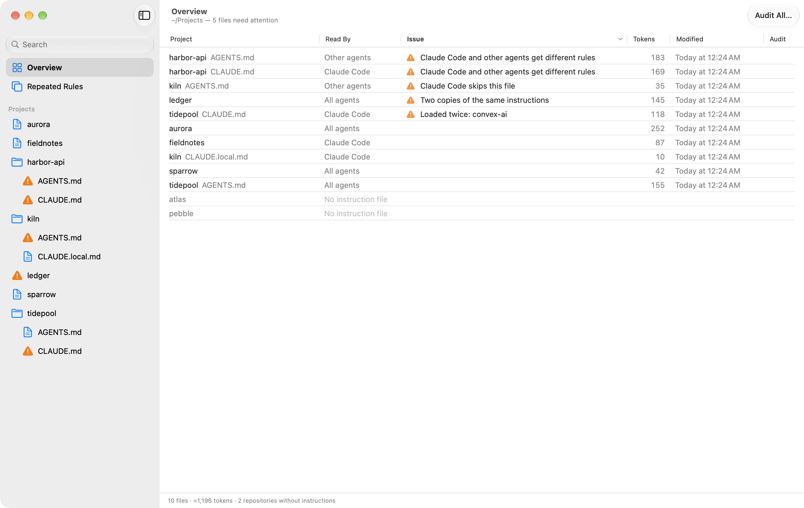
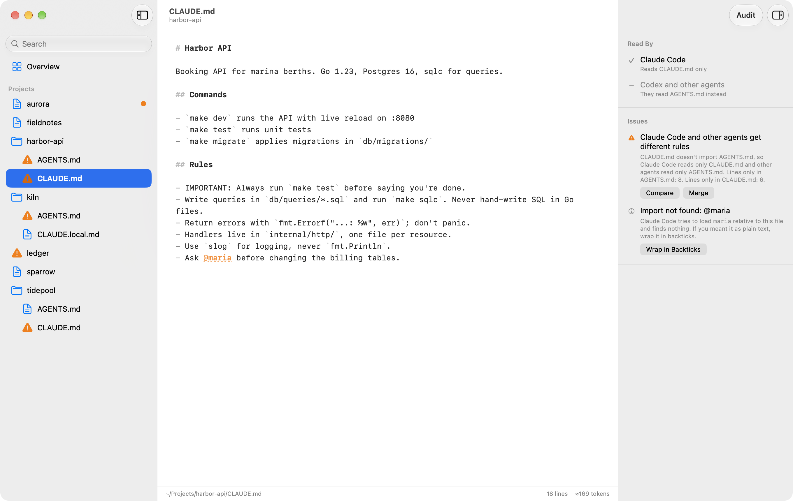
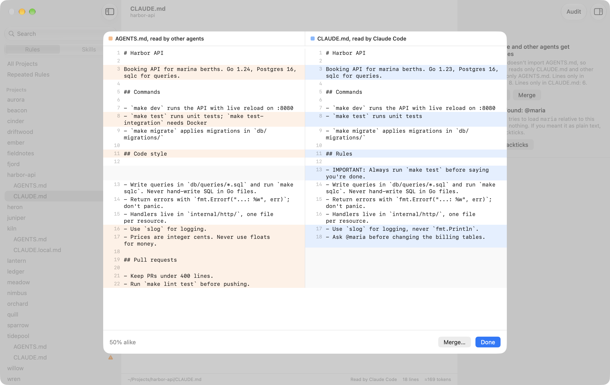
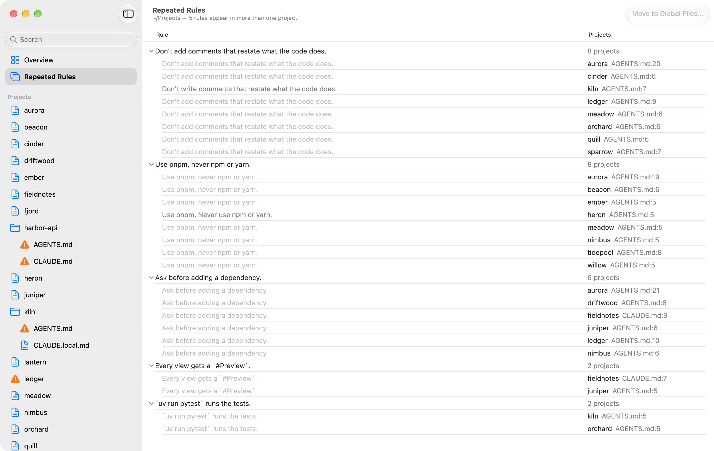
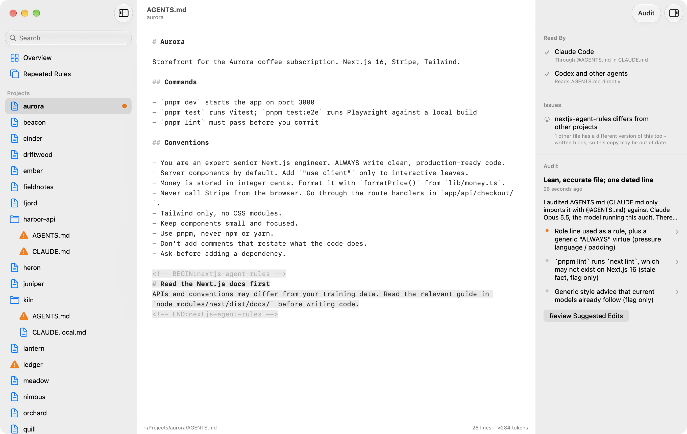

# Rulebook

**[Download for macOS](https://github.com/disinfeqt/rulebook/releases/latest/download/Rulebook.zip)** · [rulebook.duxi.ao](https://rulebook.duxi.ao)

A native macOS app for the agent instruction files across your projects. Point it at the folder that holds your projects and it finds every `CLAUDE.md`, `AGENTS.md` and `CLAUDE.local.md`, works out how they relate, and lets you edit, compare, merge and audit them in one place.



The interface comes in English and Simplified Chinese (简体中文). It follows the system language, or the one you pick in Settings, and audits are written in the same language.

## What it understands

| Status | Meaning |
|---|---|
| Linked | `CLAUDE.md` is only `@AGENTS.md`, or a symlink to it. Shown as one file. |
| Layered | `CLAUDE.md` imports `AGENTS.md` and adds Claude-only rules. |
| Duplicated | Two identical copies. Shown as one file; saving writes both. |
| Diverged | Separate files with different content: Claude Code reads only `CLAUDE.md`, other agents only `AGENTS.md`. |
| Skipped by Claude Code | `AGENTS.md` hidden by a `CLAUDE.local.md` or a parent `CLAUDE.md`. |

It also flags broken `@imports`, stray `@mentions` that Claude Code would try to import, tool-written blocks (such as `convex-ai` or `nextjs-agent-rules`) that are loaded twice or differ between projects, files over 200 lines, and titles left over from copied files. Most issues come with a one-click fix.



Rulebook watches the projects folder and your global folders, so a file changed in another editor, or a skill installed from a terminal, shows up within a second or so. Rescan (⌘R) scans on demand.

## Compare and merge

When `CLAUDE.md` and `AGENTS.md` have drifted apart, Compare shows them side by side. Merge asks your agent to combine them into one `AGENTS.md` and a `CLAUDE.md` that imports it plus any Claude-only rules. You review the result before anything is saved.



## Repeated rules

Repeated Rules lists the rules written into more than one project, such as "Always use pnpm" in seven `AGENTS.md` files. Rules that say the same thing in different words are grouped together, and each copy opens at its line.

Move to Global Files adds a rule to `~/.claude/CLAUDE.md`, which Claude Code reads in every project, and `~/.codex/AGENTS.md`, which Codex reads. The copies it covers come out of each project as unsaved changes for you to review; a copy that says more stays. Agents without a global file, like Cursor, stop getting the rule from those projects.



## Skills

A switch at the top of the sidebar turns it from rules to skills: the same projects, each with a count of its skills, and a click opens that project's. All Projects lists every skill in your projects and your home folder: who loads it, where it was installed from, and what its name and description cost in every session. Claude Code only looks in `.claude/skills`, and Codex and most other agents in `.agents/skills`, so a skill reaches every agent when one folder is linked from the other, which is how `npx skills` installs them.

| Status | Meaning |
|---|---|
| All agents | One folder, linked into both places, or two folders with the same content. |
| Claude Code or Other agents | The skill is only where one of them looks. One click links or moves it so both find it. |
| Different versions | `.claude/skills` and `.agents/skills` hold folders that differ. Compare them, then keep one. |

It also flags links that point nowhere, a SKILL.md without a description, links to files the skill doesn't have, a project skill hidden by a personal one of the same name, and copies that differ from the same skill in other projects. The skills a project got from one source are one row that opens, so forty from one repository don't fill the list. A skill opens in the editor like any other file. Select several skills, or a row that stands for a set of them, and Delete moves them to the Trash, where the folders a fix replaces go too.

## Audits

Audit (⇧⌘A) checks a file against its project: instructions written for older models, references to files and commands that don't exist, and rules that contradict each other. You get a verdict, findings that jump to the text they're about, and suggested edits as a diff. Audit All (⌥⇧⌘A) works through every file that is new or has changed, and "Audit files again when they change" in Settings keeps results current.



Audits and merges run through an agent CLI you already have, with its existing login:

| Agent | How it audits | How it's kept read-only |
|---|---|---|
| Claude Code 2.1.283+ | its own `/doctor prompt-audit` | `--restricted --strict-mcp-config`, only Read, Glob and Grep |
| Codex | the prompt in `AgentService.auditPrompt` | `--sandbox read-only --ignore-user-config` |

When a run fails, Rulebook shows what the agent reported, tries once more if the failure looks temporary, and pauses the queue if the agent has hit its usage limit. Details of every failed run go to `~/Library/Logs/Rulebook/agent.log`.

Rulebook uses the first one it finds. Settings lets you pick the agent, a model (the CLI's default otherwise) and the command's path. Runs count toward that login's usage. A typical audit takes about a minute.

## Keys

⌘O open folder · ⌘S save · ⌥⌘S save all · ⌥⌘↓ / ⌥⌘↑ next / previous file · ⇧⌥⌘↓ next file that needs attention · ⌥⌘D compare · ⇧⌘M merge · ⌘R rescan · ⌥⌘I inspector

## Install

Download [Rulebook.zip](https://github.com/disinfeqt/rulebook/releases/latest/download/Rulebook.zip), open it, and drag Rulebook to your Applications folder. It needs macOS 14 or later.

Releases are signed and notarized by Apple, and run on Apple silicon and Intel Macs. Rulebook checks for new releases and offers to install them; you can turn that off in Settings or check yourself from the Rulebook menu.

## Build

Open `Rulebook.xcodeproj` in Xcode 26 or later and run. The app runs on macOS 14 or later.

From the command line:

```sh
xcodebuild -project Rulebook.xcodeproj -scheme Rulebook -configuration Release -derivedDataPath build build
open build/Build/Products/Release/Rulebook.app
```

## Development

The app's own binary, `Rulebook.app/Contents/MacOS/Rulebook`, takes a few arguments:

- `Rulebook --dump <folder>` prints the analysis without opening a window.
- `Rulebook --root <folder> --audit <file>` runs one audit headless and stores the result where the app reads it. Add `--agent claude|codex` or `--model <name>` to choose.
- `--root <folder>`, `--no-global` and `--store <folder>` point the app at another folder and audit store without changing your settings.

`./scripts/release.sh` builds the app for both Mac architectures, signs it with a Developer ID, has Apple notarize it, and publishes it as a GitHub release, and updates `docs/appcast.xml`, the feed that copies of the app check for updates. The feed is signed with a [Sparkle](https://sparkle-project.org) key kept in the login Keychain. The website in `docs/` is deployed from this repository, and its download button always points at the latest release.

Two scripts regenerate checked-in files:

- `swift scripts/make-icon.swift` redraws the icon. It rewrites the layered `Resources/AppIcon.icon` (open it in Icon Composer to preview) and the logo files in `docs/logo`.
- `./scripts/screenshots.sh` rebuilds the screenshots above from the made-up projects in `scripts/make-demo.sh`. Add `--audit` to run a real audit for `audit.png`.

### Translations

Every string is written in English in the source, and the English text is its key. `Resources/zh-Hans.lproj/Localizable.strings` holds the Chinese. After changing any text, run `./scripts/check-strings.py`: it lists keys that are missing, unused, or whose format arguments don't match. To add a language, copy that file to a new `Resources/<code>.lproj` and translate it. Xcode picks the folder up on the next build.

## License

[MIT](LICENSE)
